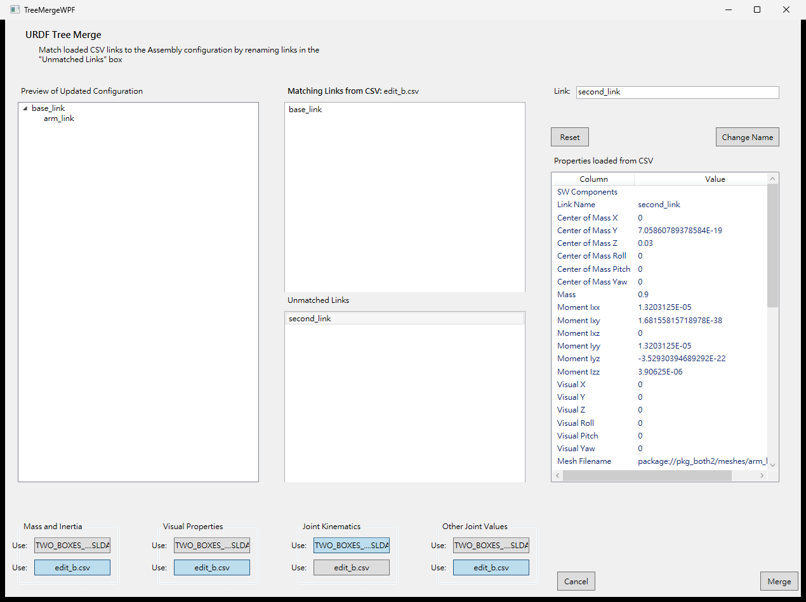

# Load from CSV / 從 CSV 載入

[English](#english) | [繁體中文](#繁體中文)

## English

**When to use it.** Use **Load from CSV...** when you keep numbers outside the model (a spreadsheet, or the CSV of an
earlier export) and want them in the next export: tuned masses and inertias, joint limits, colors. **You do not need it**
to repeat an export: the exporter already stores its settings in the model, per SolidWorks configuration, and loads
them when it opens. It can also name existing meshes: a mesh file name in the CSV is kept on export (see
[Things to know](#things-to-know)).

### What it does

Every assembly export writes a CSV next to the URDF (`<package>/urdf/<name>.csv`), one row per link. **Load from
CSV...** on the exporter's PropertyManager page reads such a file and merges its values into the link tree you are
editing. Links are paired **by name** (case sensitive); the tree itself (which link is the parent of which, the SolidWorks
components, the joint names) always comes from the model, not from the CSV.

Columns (first row is the header):

| Group | Columns |
|---|---|
| Link | `Link Name` (the key), `SW Components`, `Material Name` |
| Mass and inertia | `Center of Mass X..Yaw`, `Mass`, `Moment Ixx..Izz` |
| Visual | `Visual X..Yaw`, `Mesh Filename`, `Color Red..Alpha` |
| Collision | `Collision X..Yaw`, `Collision Mesh Filename` |
| Joint kinematics | `Coordinate System`, `Axis Name`, `Joint Name`, `Joint Type`, `Joint Origin X..Yaw`, `Parent`, `Joint Axis X..Z` |
| Other joint values | `Limit Effort/Velocity/Lower/Upper`, `Calibration rising/falling`, `Dynamics Damping/Friction`, `Safety Soft Upper/Lower`, `Safety K Position/Velocity` |

Values are in meters, kilograms and radians, as in the URDF.

### Step by step

1. Open the assembly and start **Tools > Export as URDF**, then build or check the link tree as usual.
2. Click **Load from CSV...** and choose the CSV file. If some links of the current tree are incomplete you are asked
   whether to continue; the merge still works, but check the result.
3. The **URDF Tree Merge** window opens (its texts follow the SOLIDWORKS language, English or Traditional Chinese; the screenshot is English).

   

   - **Left, "Preview of Updated Configuration"**: the link tree as it will be after the merge. It updates at once when
     you change anything. Links can be dragged inside this tree to move or reorder them.
   - **Middle**: **Matching Links from CSV** (a link of the CSV has the same name as a link of the tree) and
     **Unmatched Links** (no such link in the tree). Click a link to see its CSV values in the list on the right
     ("Properties loaded from CSV").
   - **Bottom, four groups**: *Mass and Inertia*, *Visual Properties*, *Joint Kinematics*, *Other Joint Values*. Each
     has two buttons: the upper one is labeled with the model's name (use the values of the model), the lower one with
     the CSV file name (use the CSV values). Initially Mass and Inertia, Visual Properties and Other Joint Values use the CSV;
     Joint Kinematics uses the model.
   - **Pair an unmatched link**: select it in *Unmatched Links*, type the name of the tree link in the **Link** box and click
     **Change Name**. The link moves to *Matching Links*. This renames the link only inside the window, the CSV file is not
     changed. A name must not be empty or already used by another CSV link. **Reset** only discards what you typed
     in the box and did not apply.
4. Click **Merge**. If CSV links are still unmatched you are asked to confirm; they are ignored. **Cancel** (after a confirmation) changes nothing.
5. The merged values are in the link tree of the exporter page. Nothing is written to the model until you close the page
   with OK or export.

What each group takes from the CSV, for matched links only:

- *Mass and Inertia*: center of mass pose, mass, inertia.
- *Visual Properties*: visual and collision poses, mesh file names, color and material.
- *Joint Kinematics*: joint origin, coordinate system, axis, joint type.
- *Other Joint Values*: limits, calibration, dynamics, safety controller.

### Things to know

These were checked in SolidWorks 2023 with a two-box assembly.

- **Empty cells keep the value of the model.** A group takes only the cells that are filled in. A CSV that has only
  `Link Name` and `Mass` changes the mass of the link and leaves its inertia, center of mass and the rest as they are.
  This also holds for a single component, for example a CSV with only `Joint Origin Y` changes only the Y of the origin.
- **The choice applies to the matched links only.** For a group that uses the CSV, only the links that were matched
  with a CSV row take the CSV values and are not computed for that group. Every other link (not in the CSV, for example when
  a CSV from another SolidWorks configuration lacks a link of this one, or when nothing matches at all) is still computed
  from the model on export, so it never ends up with a mass of 0 because of the CSV.
- **Mesh file names from the CSV are kept.** If *Visual Properties* uses the CSV and a matched link has a `Mesh Filename`
  (or `Collision Mesh Filename`) in the CSV, the export writes that name into the URDF and the CSV instead of
  `package://<package>/meshes/<link>.STL`. When both names of a link come from the CSV, no mesh is exported for that link
  (the file must already exist where the name points). A link without such a name, or with *Visual Properties* set to the
  model, gets the exported mesh as before. The choice is not stored in the model: load the CSV again for the next export.
- **Number format and unreadable cells.** Numbers must use `.` as decimal point, the format the exporter writes. The
  separator may be a comma, a semicolon or a tab (it is detected from the header row; Excel in some regions saves
  `;`). Before the merge window opens, the exporter lists the cells it could not read (a decimal comma such as `0,5`, text
  in a number column, a row without a link name) with their row number and column, and asks whether to continue. Those
  cells are ignored, so the model's value is kept; nothing becomes 0. A file without a `Link Name` column is rejected
  with a message.
- A row with fewer cells than the header is accepted, the missing cells are empty. The `Parent` column is informational,
  the tree is not rebuilt from it.
- After a merge the "compute" checkboxes of the exporter page stay ticked: links without CSV values are computed. Untick
  one only if you want that group not to be computed for any link.

### Common problems

- *Nothing is matched*: the link names differ. Pair them in the merge window or edit the names in the CSV.
- *The exporter says cells could not be read*: the numbers in those cells use a decimal comma or contain text. Fix them
  in the spreadsheet (use `.` as decimal point) and load the file again, or continue to ignore them.
- *A link has mass 0 after the export*: check that the model has a body for it; links that are not in the CSV are computed
  from the model.

## 繁體中文

**什麼時候用。** 當你在模型之外維護數值（試算表，或先前匯出的 CSV），想讓下一次匯出使用它們（調好的質量與慣量、
關節限制、顏色）時，使用 **從 CSV 載入…**。**只是重複匯出時不需要**：匯出器已依 SolidWorks 組態把設定存在模型內，
開啟時自動載入。它也能指定既有的 mesh：CSV 中的 mesh 檔名在匯出時會保留（見[注意事項](#注意事項)）。

### 作用

每次匯出組合件，會在 URDF 旁寫出一個 CSV（`<套件>/urdf/<名稱>.csv`），每個連桿一列。匯出器 PropertyManager 頁面的
**從 CSV 載入…** 會讀取這種檔案，把其中的值合併到目前編輯的連桿樹。連桿**依名稱**（區分大小寫）配對；樹本身
（誰是誰的父連桿、SolidWorks 元件、關節名稱）一律來自模型，不來自 CSV。

欄位（第一列為標題列）：

| 分組 | 欄位 |
|---|---|
| 連桿 | `Link Name`（比對用的鍵）、`SW Components`、`Material Name` |
| 質量與慣量 | `Center of Mass X..Yaw`、`Mass`、`Moment Ixx..Izz` |
| Visual | `Visual X..Yaw`、`Mesh Filename`、`Color Red..Alpha` |
| Collision | `Collision X..Yaw`、`Collision Mesh Filename` |
| 關節運動學 | `Coordinate System`、`Axis Name`、`Joint Name`、`Joint Type`、`Joint Origin X..Yaw`、`Parent`、`Joint Axis X..Z` |
| 其他關節值 | `Limit Effort/Velocity/Lower/Upper`、`Calibration rising/falling`、`Dynamics Damping/Friction`、`Safety Soft Upper/Lower`、`Safety K Position/Velocity` |

數值與 URDF 相同：公尺、公斤、弧度。

### 逐步操作

1. 開啟組合件，執行 **工具 > 匯出為 URDF**，照常建立或檢查連桿樹。
2. 按 **從 CSV 載入…**，選擇 CSV 檔。若目前連桿樹有未填完的連桿，會詢問是否繼續；仍可合併，但請檢查結果。
3. 出現 **URDF Tree Merge** 視窗（視窗文字依 SOLIDWORKS 語言顯示英文或繁體中文；截圖為英文版）。

   

   - **左側「Preview of Updated Configuration」**：合併後的連桿樹預覽，任何改動都會立即更新。可在此樹內拖曳連桿來
     移動或重新排序。
   - **中間**：**Matching Links from CSV**（CSV 中有與樹同名的連桿）與 **Unmatched Links**（樹中沒有同名連桿）。
     點選連桿，右側清單（「Properties loaded from CSV」）會顯示它在 CSV 中的值。
   - **下方四個分組**：*Mass and Inertia*、*Visual Properties*、*Joint Kinematics*、*Other Joint Values*。每組有兩個
     按鈕：上面的以模型名稱為標籤（使用模型的值），下面的以 CSV 檔名為標籤（使用 CSV 的值）。預設
     Mass and Inertia、Visual Properties、Other Joint Values 使用 CSV；Joint Kinematics 使用模型。
   - **配對未配對的連桿**：在 *Unmatched Links* 選取它，在 **Link** 欄輸入樹中連桿的名稱，按 **Change Name**，該連桿
     會移到 *Matching Links*。這只會在視窗內改名，CSV 檔不變。名稱不可空白，也不可與其他 CSV 連桿重複。
     **Reset** 只會捨棄欄位中輸入但尚未套用的文字。
4. 按 **Merge**。若仍有未配對的 CSV 連桿，會要求確認，這些連桿會被忽略。**Cancel**（確認後）不會改變任何東西。
5. 合併後的值出現在匯出頁面的連桿樹。在你按 OK 關閉頁面或匯出之前，不會寫入模型。

各分組對已配對連桿取自 CSV 的內容：

- *Mass and Inertia*：質心位姿、質量、慣量。
- *Visual Properties*：visual 與 collision 位姿、mesh 檔名、顏色與材質。
- *Joint Kinematics*：關節原點、座標系、軸、關節類型。
- *Other Joint Values*：限制、校準、動態、安全控制器。

### 注意事項

以下已在 SolidWorks 2023 以兩個方塊的組合件實測。

- **空白儲存格保留模型的值。** 分組只採用有填寫的儲存格。CSV 若只有 `Link Name` 與 `Mass`，只會改變該連桿的質量，
  慣量、質心等其餘值維持不變。單一分量也一樣，例如 CSV 只有 `Joint Origin Y` 時，只會改變原點的 Y。
- **選擇只對已配對的連桿生效。** 某分組使用 CSV 時，只有與 CSV 列配對成功的連桿採用 CSV 的值，且不再為該分組計算；
  其他連桿（不在 CSV 中，例如另一個 SolidWorks 組態的 CSV 缺少本組態的某個連桿，或完全沒有配對）匯出時仍由模型計算，
  不會因為 CSV 而得到質量 0。
- **CSV 中的 mesh 檔名會保留。** 若 *Visual Properties* 使用 CSV，且已配對連桿在 CSV 中有 `Mesh Filename`（或
  `Collision Mesh Filename`），匯出時會把該名稱寫入 URDF 與 CSV，而不是 `package://<套件>/meshes/<連桿>.STL`。
  當連桿的兩個名稱都來自 CSV 時，不會為該連桿匯出 mesh（檔案必須已存在於名稱所指的位置）。沒有這類名稱的連桿，或
  *Visual Properties* 設為模型時，仍照原來方式取得匯出的 mesh。此選擇不會存入模型：下次匯出要再載入 CSV。
- **數字格式與無法讀取的儲存格。** 數字必須以 `.` 為小數點，也就是匯出器寫出的格式。分隔符號可以是逗號、分號或
  Tab（由標題列自動判斷；部分地區的 Excel 會存成 `;`）。在合併視窗開啟之前，匯出器會列出無法讀取的儲存格（小數逗號如
  `0,5`、數字欄中的文字、沒有連桿名稱的列）與其列號、欄位，並詢問是否繼續。這些儲存格會被忽略，因此保留模型的值，
  不會變成 0。沒有 `Link Name` 欄的檔案會被拒絕並顯示訊息。
- 儲存格數少於標題列的列可以接受，缺少的儲存格視為空白。`Parent` 欄僅供參考，不會據以重建樹。
- 合併後，匯出頁面的「計算」核取方塊維持勾選：沒有 CSV 值的連桿會被計算。只有在你希望某分組對所有連桿都不計算時，
  才取消勾選。

### 常見問題

- *完全沒有配對*：連桿名稱不同。在合併視窗內配對，或直接改 CSV 內的名稱。
- *匯出器提示有儲存格無法讀取*：那些儲存格的數字使用了小數逗號或含有文字。請在試算表中修正（小數點用 `.`）後重新載入，
  或選擇繼續並忽略它們。
- *匯出後某連桿質量為 0*：請檢查模型中該連桿是否有實體；不在 CSV 中的連桿由模型計算。
